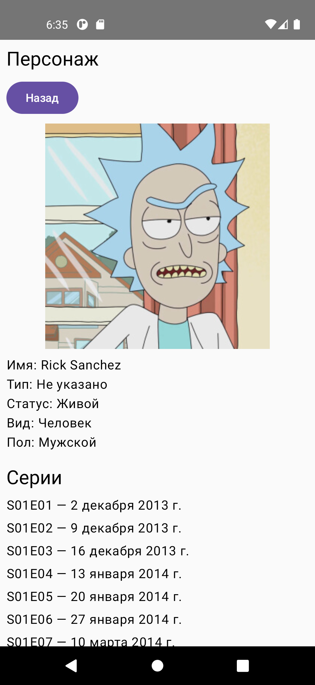

# Rick and Morty — лабораторная 8

Лабораторная работа №8. Приложение показывает персонажей
из Rick and Morty: список с фото и подгрузкой новых страниц, а если нажать
на персонажа — его данные и серии, в которых он появлялся.

Что делает:
- два экрана, у каждого своя ViewModel и своё состояние;
- данные берутся с rickandmortyapi.com через Retrofit и корутины;
- есть DI (AppContainer) и репозиторий;
- список подгружается с пагинацией, при ошибке можно нажать «Повторить».

